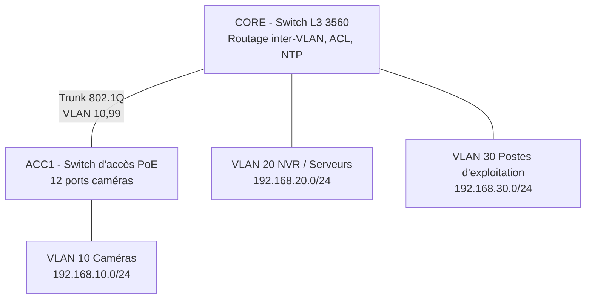

# Réseau de vidéosurveillance IP – conception et configuration

Conception d'un réseau IP dédié à la vidéosurveillance d'un site tertiaire : 12 caméras, un enregistreur (NVR) et deux postes d'exploitation. Le projet fait le lien entre l'étude de sûreté électronique (bilan PoE, débit, stockage) et la configuration réseau Cisco qui isole et sécurise le flux vidéo.

**Outils :** Cisco Packet Tracer 8.x (switch L3 3560, switch d'accès 2960)

## Topologie

## Choix de conception

| Besoin | Solution |
|---|---|
| Isoler le flux vidéo du reste du réseau | VLAN dédiés caméras / NVR / exploitation |
| Une caméra compromise ne doit atteindre que le NVR | ACL sur la SVI VLAN 10 : caméras → NVR uniquement |
| Pas d'accès direct aux caméras depuis les postes | ACL sur la SVI VLAN 30 : accès au NVR seulement (HTTP/HTTPS, RTSP, SDK) |
| Horodatage fiable des enregistrements | Switch CORE serveur NTP, seul service autorisé pour les caméras |
| Empêcher le branchement d'un équipement pirate | Port security (1 MAC par port), ports inutilisés désactivés, BPDU guard |
| Limiter les tempêtes de broadcast | Storm control sur les ports caméras |
| Prioriser le flux vidéo | Confiance DSCP (QoS) sur les uplinks (matériel réel, voir docs) |

## Dimensionnement

Calcul détaillé dans [`docs/dimensionnement.md`](docs/dimensionnement.md) :
- **Débit total :** 12 caméras × 4 Mbit/s = 48 Mbit/s, ce qui laisse une large marge sur un uplink 1 Gbit/s
- **Stockage :** 30 jours d'enregistrement continu ≈ 15,6 To, soit environ 18,7 To avec 20 % de marge
- **Budget PoE :** environ 84 W en consommation réelle, 185 W au pire cas (classe 3)

## Contenu du dépôt

- [`docs/plan-adressage.md`](docs/plan-adressage.md) : VLAN, adresses, ports
- [`docs/dimensionnement.md`](docs/dimensionnement.md) : bilan PoE, débit, stockage
- [`configs/`](configs/) : configurations de CORE et ACC1
- [`docs/verification.md`](docs/verification.md) : tests de flux autorisés et bloqués
- `captures/` : captures d'écran des tests

## Limites de la simulation

Packet Tracer ne propose pas de switch 2960 PoE et ne gère que partiellement la QoS. Les caméras et le NVR y sont simulés par des PC ou serveurs génériques en adressage statique. La partie QoS est documentée pour du matériel réel.

## Avancement

- [x] Conception, plan d'adressage et dimensionnement
- [x] Configurations CORE et ACC1
- [ ] Topologie montée dans Packet Tracer (fichier `.pkt` à ajouter)
- [ ] Tests de flux effectués et capturés
- [ ] Extension : redondance de l'uplink (EtherChannel LACP), supervision SNMP/Syslog

## Auteur

Youssef Bahannis, ingénieur électronique et réseaux de télécommunications (INSA Rennes), chargé d'études en sûreté électronique
